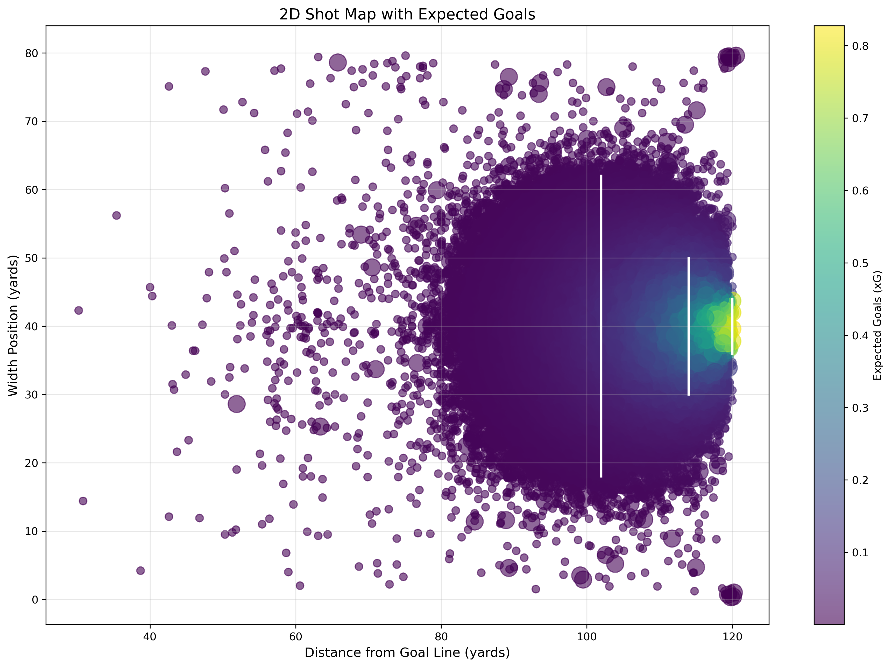

# Expected Goals (xG) Model

A logistic regression model that estimates the probability that a soccer shot results in a goal, trained on **87,111 shots** from [StatsBomb Open Data](https://github.com/statsbomb/open-data).

Part of a team project at the Illinois Mathematics Lab (UIUC, Fall 2024) by Andy Song, Jake Summaria, Samy Bouzamondo, and Yifeng Luo, mentored by Kiran Luecke and Yigal Kamel. This repository contains the shot-location xG model (Section 2.3 of the report). The full team work, including the clutch-goal analysis and the perceived-length and freeze-frame refinements, is in the report and poster:

- [Final report (PDF)](docs/xG_final_report_IML_Fall2024.pdf)
- [Poster (PDF)](docs/xG_poster_IML_Fall2024.pdf)

## Results

5-fold stratified cross-validation (`evaluate_xg.py`):

| Model | AUC | Log loss | Brier score |
|---|---|---|---|
| Baseline (predict 11.1% goal rate for every shot) | 0.500 | 0.349 | 0.0987 |
| **Logistic regression (x, y, distance, angle)** | **0.750** | **0.308** | **0.0896** |

The model cuts log loss by 12% relative to the base-rate baseline. Shot distance is the strongest predictor (standardized coefficient −1.13), followed by horizontal position x (−0.38) and shot angle (+0.23).



## Method

1. **Data extraction**: parse StatsBomb event JSON files and keep events with `type == "Shot"`. Label each shot `is_goal = 1` if its outcome is `Goal`.
2. **Feature engineering** from shot coordinates (pitch is 120 × 80 yards; goal posts at y = 36 and y = 44):
   - `distance_to_goal`: Euclidean distance to the center of the goal.
   - `shot_angle`: angle subtended by the two goal posts, computed with the law of cosines.
   - `x`, `y`: raw shot location.
3. **Model**: features standardized with `StandardScaler`, then fitted with `LogisticRegression`. The final formula is in [`data_cleaning/xg_formula.txt`](data_cleaning/xg_formula.txt).
4. **Evaluation**: AUC measures ranking ability. Log loss and Brier score measure probability calibration, which matters because xG is used as a probability.

## Repository structure

```
data_cleaning/
  xg_model.py          # extract shots, engineer features, train model, export results
  shot_data.json       # 87,111 processed shots with model predictions
  xg_formula.txt       # fitted model formula
evaluate_xg.py         # cross-validated evaluation vs. baseline
  web-scraping/        # exploratory FBref scraping (2022 World Cup final shot and player tables)
xg-visualization/      # Next.js app plotting xG by distance, angle, and location
```

## Reproduce

```bash
git clone https://github.com/statsbomb/open-data.git
pip install pandas numpy scikit-learn matplotlib seaborn tqdm
cd data_cleaning && python xg_model.py       # expects ../open-data/data/events
cd .. && python evaluate_xg.py
```

Visualization app:

```bash
cd xg-visualization && npm install && npm run dev
```

## Notes on the report's evaluation

- The report cites "76% prediction accuracy". Accuracy is not informative here: only 11.1% of shots are goals, so predicting "no goal" for every shot already scores 88.9%. The cross-validated AUC, log loss, and Brier score above are the metrics to use.
- The report's "penalty spot ≥ 0.7 xG" reflects the actual conversion rate of shots taken from the penalty spot (67% across 1,393 shots), most of which are penalty kicks. Because this model does not separate penalties from open play, it predicts about 0.18 at that location.

## Limitations and next steps

- Penalties are not modeled separately; adding shot type would fix the penalty-spot gap above.
- Uses location features only. Adding body part, shot type (open play, set piece, penalty), and assist type would likely improve AUC.
- Logistic regression assumes a linear relationship in log odds; a gradient-boosted model could capture interactions between distance and angle.
